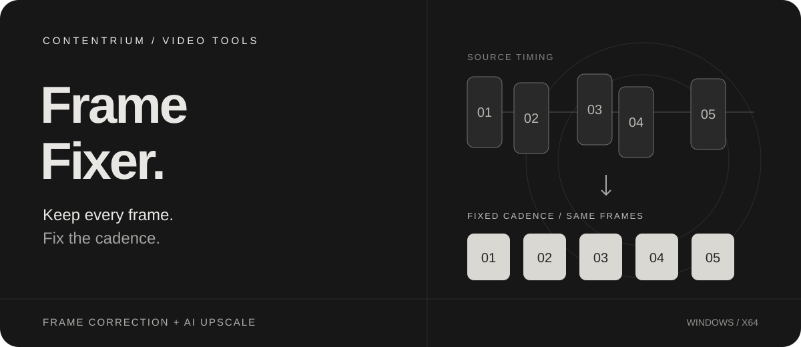
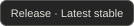
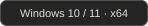
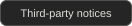
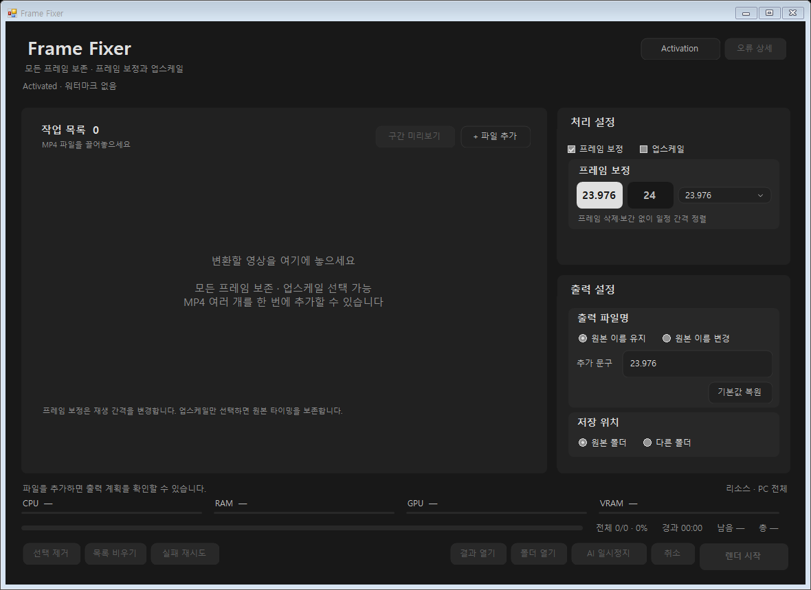
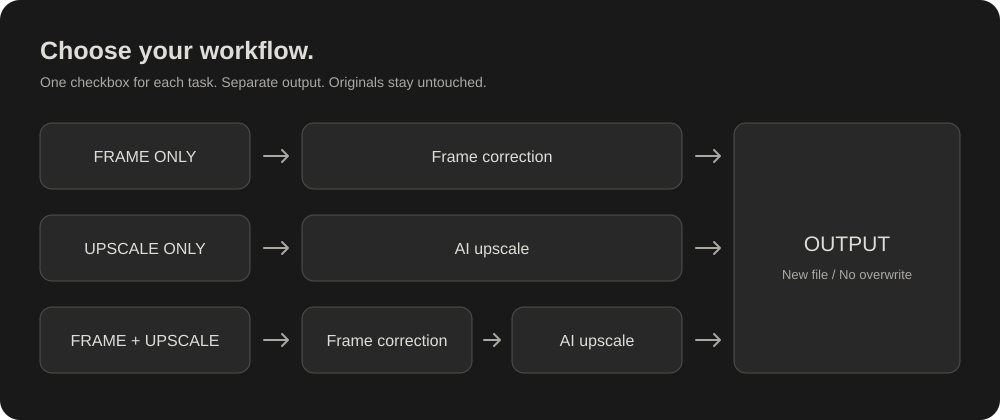

<p align="center">
  
</p>

<h1 align="center">Frame Fixer</h1>

<p align="center">
  <strong>모든 프레임은 그대로. 더 일정하게, 더 선명하게.</strong><br>
  AI로 생성한 영상의 프레임 간격을 정리하고, 필요할 때 업스케일하는 Windows 앱입니다.
</p>

<p align="center">
  <a href="https://github.com/contentriumkorea/frame-fixer/releases/latest"></a>
  <a href="#적용-범위와-제한"></a>
  <a href="#개인정보와-라이선스"></a>
</p>

<p align="center">
  <a href="#빠르게-시작하기">설치하기</a> ·
  <a href="https://github.com/contentriumkorea/frame-fixer/releases/download/installer-v1/FrameFixer-Setup.exe">다운로드</a> ·
  <a href="#사용-모습">사용 모습</a> ·
  <a href="#상세-안내">상세 안내</a>
</p>

---

## 빠르게 시작하기

**Windows 10/11 x64 · 최초 설치 시 인터넷 필요.** 업스케일은 NVIDIA GPU가 필요합니다.

<p>
  <a href="https://github.com/contentriumkorea/frame-fixer/releases/download/installer-v1/FrameFixer-Setup.exe"></a>
</p>

설치파일 실행 → 최신 정식 버전 다운로드·검증 → 설치 화면에서 조건 확인 → **Frame Fixer 실행**.

같은 경량 설치파일을 보관해 두고 다시 사용할 수 있습니다. 정상적인 기존 AI 모델·영상 도구는 재사용합니다.

[설치·업데이트·제거 안내 →](#설치와-업데이트) · [최신 버전과 변경 사항 →](https://github.com/contentriumkorea/frame-fixer/releases/latest)

## 영상 정리, 필요한 작업만 선택하세요

| 01 · 프레임 보정 | 02 · 업스케일 | 03 · 일괄 작업 |
| :--- | :--- | :--- |
| **삭제·복제 없이 일정한 간격으로** | **비율을 지키며 더 큰 화면으로** | **여러 파일을 한 번에** |
| 원본의 모든 프레임과 순서를 유지해 선택한 FPS로 재배열합니다. 프레임 보간은 하지 않습니다. | 단독으로 사용하거나 프레임 보정 후 이어서 처리합니다. FHD 최소·4K 최소·원본 2배를 선택합니다. | 파일명·저장 위치 변경이 대기 목록에 바로 적용됩니다. 파일별·전체 진행률과 예상 남은 시간을 확인합니다. |

## 사용 모습

<p align="center">
  
</p>

**왼쪽은 작업 목록, 오른쪽은 처리 설정과 출력 설정.**

실제 앱의 UI 검증 과정에서 캡처한 빈 작업 목록 화면입니다. 활성화된 테스트 환경이며, 디자인 시안이나 화질 비교 이미지는 아닙니다. 창 테두리는 Windows 환경에 따라 달라질 수 있습니다.

<details>
<summary><strong>처리 흐름과 추가 예시 보기</strong></summary>

<p align="center">
  
</p>

위 그림은 실제 지원하는 작업 순서를 설명한 도식입니다. 두 항목을 모두 체크하면 **프레임 보정 → 업스케일** 순서로 처리합니다.

FHD 최소를 선택했을 때의 출력 크기 예시:

| 원본 | 출력 | 이유 |
| :--- | :--- | :--- |
| 1280 × 720 | 1920 × 1080 | 16:9 비율로 확대 |
| 1276 × 720 | 1920 × 1084 | 원본 비율을 기준으로 확대하고 짝수 올림 |
| 1024 × 768 | 1920 × 1440 | 자르거나 눌러 맞추지 않고 두 축의 최소값 충족 |

</details>

## 설치와 업데이트

| 방식 | 사용 방법 |
| :--- | :--- |
| **처음 설치 · 권장** | 위의 **FrameFixer-Setup.exe**를 실행합니다. 특정 앱 버전에 고정되지 않고 최신 정식 설치용 본체를 내려받습니다. |
| **버전별 설치파일** | [최신 릴리스](https://github.com/contentriumkorea/frame-fixer/releases/latest)의 `FrameFixer-버전-Setup.exe`로 설치할 수 있습니다. 영상 도구·AI 준비에는 인터넷이 필요할 수 있습니다. |
| **앱에서 업데이트** | 실행 시 백그라운드로 확인합니다. 알림에서 **지금 업데이트** 또는 나중을 선택합니다. 다운로드·검증 후 설치와 재시작을 연결하며, 작업 중에는 안전한 시점까지 설치를 미룹니다. |
| **종료 · 제거** | 트레이에서 창 열기·완전 종료가 가능합니다. Windows 설정의 **설치된 앱** 또는 **프로그램 및 기능**에서 제거합니다. 사용자 설정·Activation·캐시·원본·완료 영상은 보존합니다. |

경량 설치기는 최초 설치 진입점이며 앱 내부 업데이터와는 별개입니다. 다운로드·검증·설치 실패 시 오류 내용을 확인하고 **다시 시도**할 수 있습니다. 현재 공식 안내는 설치형 배포 기준이며, GitHub의 **Source code ZIP은 실행용 포터블이 아닙니다.**

> 현재 배포본에는 Windows 게시자 코드 서명이 없습니다. 보안 정책에 따라 경고나 차단이 발생할 수 있습니다. 보안 설정을 끄지 말고 공식 배포처를 확인하세요.

## 이렇게 사용하세요

1. MP4 영상을 작업 목록에 끌어넣습니다.
2. **프레임 보정 / 업스케일** 체크박스로 필요한 작업을 선택합니다.
3. 목표 FPS 또는 업스케일 크기를 정합니다.
4. 오른쪽 아래에서 **출력 파일명·저장 위치**를 확인합니다.
5. **렌더 시작**을 누릅니다. 전체 목록이 끝나면 알림음이 한 번 재생됩니다. 취소 시에는 재생하지 않습니다.

```text
프레임 보정만  →  23.976 FPS 선택  →  원본이름(23.976).mp4
업스케일만    →  FHD 최소 선택   →  원본 시간 정보를 유지하며 확대
둘 다 선택    →  프레임 보정     →  업스케일 → 별도 파일 저장
```

기본 FPS는 **23.976**이며 24·25·29.97·30·50·59.94·60도 지원합니다. 출력 이름의 앞부분과 괄호 안 문구를 수정할 수 있습니다. 원본 폴더 또는 다른 저장 폴더를 선택하며 **원본과 기존 출력 파일은 덮어쓰지 않습니다.** 임시 작업은 선택한 저장 폴더를 사용합니다.

## 적용 범위와 제한

| 항목 | 알아두세요 |
| :--- | :--- |
| **지원 입력** | MP4 · H.264 8비트 SDR · AAC 오디오 또는 무음. 지원하지 않는 입력은 이유를 표시합니다. |
| **프레임과 오디오** | 프레임 보정은 원본 해상도를 유지하며 길이는 `프레임 수 ÷ 목표 FPS`로 바뀝니다. 오디오 속도는 바꾸지 않고 처음부터 재생합니다. 단독 업스케일은 원본 시간 정보와 오디오의 상대 시작점을 유지합니다. |
| **업스케일 크기** | FHD 최소·4K 최소는 가로·세로 기준을 모두 충족하도록 원본 비율 기준으로 확대합니다. 이미 두 기준을 만족하면 확대하지 않습니다. 자르기·여백 추가·축소 없이 필요한 축을 2픽셀 미만으로 짝수 올림합니다. |
| **업스케일 사양** | NVIDIA VRAM **16GB 이상 권장**. 총 VRAM 12GB와 현재 여유 10GB 이상을 검사합니다. 최초 AI 준비 다운로드는 약 6.88GB이며 여유 저장 공간 16GB 이상을 권장합니다. 모든 GPU·드라이버 조합을 검증한 것은 아닙니다. |
| **GPU 메모리** | Frame Fixer의 **1GiB 여유 정책**을 사용합니다. 다른 앱을 포함한 PC 전체 VRAM 사용량을 절대 한도로 통제하는 기능은 아닙니다. |
| **화질과 용량** | 실제 화질·오디오 보존이 기준입니다. 원본 대비 용량 100–105%는 보장하지 않으며, 무손실 결과와 임시 파일이 크게 늘 수 있습니다. 일부 편집기·플레이어에서 무손실 출력이 열리지 않을 수 있으므로 원본을 보관하세요. |
| **AI 처리** | AI는 새로운 디테일을 생성합니다. 실제 원본 디테일 복원이나 모든 장면의 개선을 보장하지 않습니다. 마지막 저장·검증 단계에는 CPU와 디스크도 사용합니다. |
| **무료 이용** | 활성화 없이 길이 제한 없이 모든 기능을 사용할 수 있습니다. 무료 출력 중앙에는 **불투명도 20%의 Contentrium 로고**가 들어갑니다. |
| **Activation** | 상단 **Activation**에서 코드를 등록하면 이후 출력의 워터마크가 제거되며 등록 상태는 유지됩니다. 기존 출력 파일은 소급 변경하지 않습니다. |

<a id="상세-안내"></a>
<details>
<summary><strong>상세 안내와 검증 범위</strong></summary>

### 설치 환경과 오류 확인

Windows 10/11 x64 및 .NET Framework 4.8이 필요합니다. 다른 운영체제나 CPU 구조에 맞는 패키지가 없으면 설치하지 않고 안내합니다. 바탕화면·시작 메뉴 바로가기와 작업표시줄 표시·고정을 지원합니다. 제거 시 앱 파일·등록 정보·생성한 바로가기를 정리합니다.

오류가 발생하면 앱의 **오류 상세**에서 내용을 확인하고 복사해 전달할 수 있습니다. 파일별·전체 진행률, 경과·예상 남은 시간과 리소스 표시를 제공합니다. 리소스 수치는 PC 전체 기준이며, 남은 시간은 작업 중 변할 수 있는 추정값입니다.

### 화질 보존 방식

일반 프레임 보정은 가능한 경우 원본 압축 데이터를 유지하고, 불가능하면 무손실 인코딩 후 실제 프레임 픽셀·개수·시간·해상도·색 정보·오디오를 검증합니다. 프레임을 삭제·복제·보간하지 않습니다. 23.976은 정확한 `24000/1001` 기준입니다. 파일 용량이나 비트레이트만으로 화질을 판단하지 않습니다.

### 현재 배포와 확인 범위

현재 정식 버전은 **2.1.7**입니다. 경량 설치기, 바탕화면 바로가기 기본 생성, 트레이의 창 열기·완전 종료가 추가되었습니다. 기존 프레임 보정·업스케일·화질 검증 방식과 정상 캐시는 유지합니다.

설치기의 최신 버전 확인·다운로드 검증과 Windows 설치 교체, 바로가기·제거 등록, 앱 시작·종료를 확인했습니다. 본문의 앱 화면은 UI 자동 검증에서 캡처했습니다. 모든 PC의 설치 성공, AI 처리 속도나 모든 영상의 화질 향상을 보장하는 의미는 아닙니다.

[릴리스별 변경 사항 확인 →](https://github.com/contentriumkorea/frame-fixer/releases/latest)

</details>

<a id="개인정보와-라이선스"></a>
<details>
<summary><strong>개인정보와 라이선스</strong></summary>

영상이나 오류 보고서는 자동으로 외부에 업로드하지 않습니다. 외부 통신은 필요한 구성요소·업데이트 확인과 다운로드에 사용합니다. 설치 화면에서 영상 도구·AI 구성요소 이용 조건을 확인하고 동의합니다. 오류 상세는 사용자가 직접 복사해 전달합니다.

제3자 도구와 모델의 권리는 각 권리자에게 귀속됩니다. 영상 도구는 [Gyan 공급처](https://www.gyan.dev/ffmpeg/builds/)의 고정 패키지를 받고 [FFmpeg 라이선스](https://ffmpeg.org/legal.html)를 따릅니다. AI 모델은 공식 [SeedVR2 모델 저장소](https://huggingface.co/numz/SeedVR2_comfyUI)에서 고정 버전을 받습니다. 필요한 수정 소스·변경 고지·라이선스는 설치 폴더의 `ai`와 고지 파일에 보관합니다. [CUDA 이용 조건](https://docs.nvidia.com/cuda/archive/12.8.1/eula/index.html)과 [cuDNN 이용 조건](https://docs.nvidia.com/deeplearning/cudnn/backend/v9.10.2/reference/eula.html)도 설치 시 안내합니다.

</details>

<details>
<summary><strong>English overview</strong></summary>

Frame Fixer is a Windows 10/11 x64 app for AI-generated video. It retimes every original frame to a fixed cadence without dropping, duplicating or interpolating frames. Use frame correction, AI upscaling, or both in that order.

Download **FrameFixer-Setup.exe** above. The lightweight online installer retrieves and verifies the latest stable setup. Existing valid models and video tools are reused. AI upscaling requires an NVIDIA GPU; 16GB VRAM is recommended. Supported input: MP4 with 8-bit SDR H.264 video and AAC audio, or no audio.

All features are available without activation, with a centered 20%-opacity Contentrium watermark. Activation removes the watermark from future renders. Lossless output can be much larger and may not open in every editor. AI-generated details are not guaranteed to match real source details. Current installers are not Windows publisher-code-signed. Media and diagnostics are not automatically uploaded.

</details>

---

<p align="center">
  <strong>CONTENTRIUM</strong><br>
  <a href="#개인정보와-라이선스">라이선스·이용 조건</a> ·
  <a href="https://github.com/contentriumkorea/frame-fixer/releases/latest">Latest release</a>
</p>

<sub>Frame Fixer by Contentrium. 제3자 도구·모델과 상표의 권리는 각 권리자에게 귀속됩니다.</sub>

<p align="center">
  <a href="https://contentrium.com/"></a>
</p>
